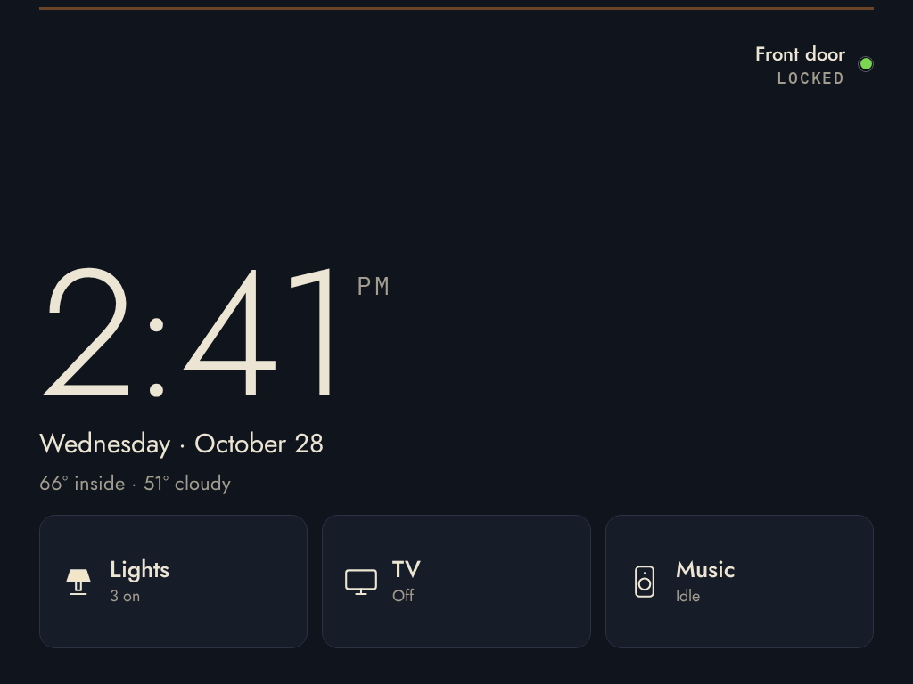

# Jam Cards

Saul Bass inspired Lovelace cards for Home Assistant, poster style: flat colour blocks on an ink ground, straight edges
with one cut corner, one accent colour per card (per room), heavy uppercase display type.


## Install
1. HACS → Custom repositories → `Starkkaman/jam-cards`, category **Dashboard** → Download. The resource is added for you.
2. For the palette, also install the [JamBoard theme](https://github.com/Starkkaman/jam-theme) (HACS category **Theme**)
   and select it. It sets the `--jam-*` colours per light/dark mode; without it the cards fall back to the dark "ink" palette.

Twenty-five cards have a visual editor and a live preview in the card picker: jam-heading, jam-hero, jam-tile, jam-choice,
jam-slider, jam-button, jam-gauge, jam-fan, jam-weather, jam-graph, jam-alerts, jam-light, jam-speaker, jam-media,
jam-house, jam-screensaver, jam-list, jam-panel, jam-tabs, jam-scenes, jam-tv (main options and sources), jam-looks, jam-dial, jam-keypad and jam-radio. List options
such as hero chips, list rows, panel rows, tabs, scenes, house alerts, light whites / presets, speaker pins, screensaver
`now` and TV sources are edited as a list of items (Home Assistant 2026.10 or newer). Options the form does not show
(tile tones, fan speeds / presets, jam-media `sources` / `more`, TV `stereo` / `remote_card`, screensaver `kiosk` ...)
stay YAML and are kept when you edit the form; a config the form cannot show (a bare id in a list of `{entity, name}`
items, a bare uri among pins) opens in the YAML editor instead. jam-remote, jam-kiosk and jam-popup are YAML only (the
tables below). The screensaver stays inert in the picker and while the dashboard is in edit mode. Unknown or unavailable
entities render as unavailable instead of throwing.
Fonts (OFL): Londrina Solid and Jost (the default look) are embedded in `jam-cards.js` (latin subset); the other looks'
fonts are files in `fonts/` next to it, loaded only while that look is active. Licences are in `dist/fonts/`. Nothing is
fetched from outside Home Assistant (the screensaver's `images.index` is whatever URL you configure).

**0.10.0: state grammar, opt-in attention, look cards, two more looks.** One state grammar in every look: on is the
strongest fill the look owns, off is quiet, a lock is never "on" (unlocked / open / jammed are alerts, locked is quiet),
trouble sensors (problem, moisture, smoke, gas, CO, safety, tamper, battery, heat, cold) are alerts while on, and an
unreachable entity reads **Offline** on a broken form; jam-kiosk and jam-screensaver share one date line. Labels are at
least 12 px and chips 13 px everywhere. New opt-ins (all off by default, so live dashboards keep their look): jam-kiosk
`dock_state: fill`, `attention`, `now_band` and `sheet_heading: false`; `size: kiosk` on jam-light, jam-scenes and jam-fan;
jam-speaker `compact_idle`; jam-screensaver `lock_entity` and `alerts`; jam-house `attention`. Three look cards drawn after
Braun objects, at home in every look: [jam-dial](#jam-dial), [jam-keypad](#jam-keypad) and [jam-radio](#jam-radio). Two
more looks: **Jam Brutal** (neo-brutalism: bordered white slabs, hard shadows, keys that go down) and **Jam Glass** (liquid
glass + bento over a soft colour field; set `fx: false` on jam-kiosk / jam-screensaver for weak kiosk tablets). Update the
[jam-theme](https://github.com/Starkkaman/jam-theme) repo too. For look packs: jam-kiosk dock blocks carry
`data-state="on|off|action"` (plus `data-alert`), and jam-light / jam-button / jam-tile / jam-fan hosts carry
`data-state="on|off|offline"`.

**0.9.0: four more looks.** **Jam Transit** (Vignelli's subway signs: black signs, route bullets, yellow alerts), **Jam
Grid** (Crouwel's New Alphabet: a page grid, one signal colour, big numbers built from grid cells), **Jam Pulsar**
(Factory Records: a black field with thin rules, ridge-line levels, colour codes) and **Jam New Wave** (April Greiman:
tinted translucent planes, confetti, pixel type; set `fx: false` on jam-kiosk / jam-screensaver for weak kiosk tablets).
Update the [jam-theme](https://github.com/Starkkaman/jam-theme) repo too, then pick a look in your profile. **Jam
Braun** has more colour (lit lights tinted in their own colour, the ET66 yellow and olive keys, room-coloured heading
rules, tinted dock blocks and bands). New [jam-looks](#jam-looks) card: a per-user look picker with a live swatch per
look (it sets your own theme, like Profile → Theme). Visual editors now cover 21 cards (plus jam-looks), list options
included (Home Assistant 2026.10 or newer).

**0.8.0: looks.** Two new looks next to Poster, Braun and Olympia: install or update the
[jam-theme](https://github.com/Starkkaman/jam-theme) repo and switch with Home Assistant's theme picker (profile, or
`frontend.set_theme`): **Jam Braun** or **Jam Olympia** (JamBoard = Poster). Also visual editors for 13 cards, a short
error strip on the card for failed taps (instead of Home Assistant's raw error), and `dist/` packaging (below).

**Upgrading from 0.7.x (files moved to `dist/`).** The repository now ships `dist/jam-cards.js` plus `dist/fonts/`; HACS
downloads the whole `dist/` folder into the same place as before, so the dashboard resource stays
`/hacsfiles/jam-cards/jam-cards.js` and nothing needs changing: update in HACS and reload the browser. The look fonts are then
served from `/hacsfiles/jam-cards/fonts/`. Manual installs: copy the whole `dist/` folder (not only `jam-cards.js`) to
`www/jam-cards/` and keep the resource `/local/jam-cards/jam-cards.js`; if the fonts are missing, the looks fall back to
system fonts and nothing else breaks.

## Colours
Every card takes `accent:` — `ochre` (default), `teal`, `blue`, `pink`, `violet`, `green`, `red`, or a room alias:
`living` (ochre), `kitchen` (teal), `master` (blue), `marissa` (pink), `music` (violet), `nerd` (green), `alert` (red).
Anything that is on or selected fills with the accent (ink text); idle controls stay neutral. Red is meant for alerts:
unavailable states, jammed locks and power keys are always red. Cards inside a `jam-popup` follow the pop-up's accent
unless they set their own; inside pop-ups and sheets their surfaces move one step up (card face `--jam-slab2`, inner
keys `--jam-slab3`) so they stand out from the sheet. Status colours: accent = on/active, red = alert/unavailable, teal = calm/informational, line = off.

## Actions
Cards that list `tap_action`, `hold_action` (500 ms) or `double_tap_action` accept standard Lovelace action objects:
`more-info`, `toggle`, `navigate` (`navigation_path`), `url` (`url_path`), `perform-action` / `call-service`
(`perform_action`, `data`, `target`) and `none`. Add `confirmation: true` or `confirmation: {text: ...}` to ask first.

## Cards
36 cards (look cards, at home in every look: jam-dial, jam-keypad and jam-radio are drawn after Braun objects; jam-pictogram, jam-programme and jam-results were made for Olympia; jam-linemap and jam-arrivals for Transit, jam-matrix for Grid, jam-ridge for Pulsar and jam-sticker for New Wave). Every card takes `accent`. The full option list of each card is in the header comment of `src/cards/jam-*.js`.

### jam-heading
Section label with a big title over a 5px accent rule.
```yaml
type: custom:jam-heading
title: Living room
kicker: Downstairs
```
| Option | Description |
|---|---|
| `title` | Title (required) |
| `kicker` | Small label above the title |
| `accent` | Rule colour (see Colours) |
| `entities` | List of entity ids shown as state chips |
| `tap_action`, `hold_action`, `double_tap_action` | Actions |

### jam-hero
Paper slab with a cut corner: a big title (fixed or from an entity), meta line and chips.
```yaml
type: custom:jam-hero
kicker: Living room TV
title_entity: sensor.tv_current_app
power_entity: switch.tv_power
off_title: TV off
```
| Option | Description |
|---|---|
| `kicker` | Small label above the title |
| `title` / `title_entity` | Fixed title, or an entity whose state is the title |
| `meta_entities` | List of entity ids shown as a meta line |
| `power_entity` | When off, shows `off_title` / `off_text` instead |
| `off_title`, `off_text` | Text shown while `power_entity` is off |
| `chips` | List of `{entity, name, show_state, hide_value, tone}`; a chip is hot (accent colour) when its entity is on; `show_state` shows the chip only in that state; `hide_value` hides the value; `tone`: any accent name, or `paper` |
| `accent` | Hot chips and separators (default ochre; see Colours) |

### jam-tile
Entity block with a status stripe and an optional control.
```yaml
type: custom:jam-tile
entity: switch.coffee_machine
```
| Option | Description |
|---|---|
| `entity` | Entity id (required) |
| `name` | Name override |
| `label` | Fixed text instead of the state |
| `control` | `auto` / `toggle` / `lock` / `press` / `none` (auto: lock → lock, button → press, on/off → toggle) |
| `tones` | Map of state → `on` / `alert` / `calm` / `off` |
| `show_last_changed` | Show when the state last changed |
| `tap_action`, `hold_action`, `double_tap_action` | Actions |

### jam-choice
A `select` / `input_select` as option chips; the selected one fills with the accent.
```yaml
type: custom:jam-choice
entity: input_select.house_mode
```
| Option | Description |
|---|---|
| `entity` | select / input_select (required) |
| `name` | Name override |
| `options` | Subset and order of options to show |
| `columns` | Number of chip columns |

### jam-slider
Strip for number / input_number, light brightness, media volume or fan speed.
```yaml
type: custom:jam-slider
entity: light.desk
```
| Option | Description |
|---|---|
| `entity` | number / input_number / light / media_player / fan (required) |
| `name` | Name override |
| `min`, `max`, `step` | Range overrides |

### jam-media
Now playing as a duotone print, with transport, volume, sources, player switch and grouping.
```yaml
type: custom:jam-media
entity: media_player.kitchen
```
| Option | Description |
|---|---|
| `entity` | media_player (required) |
| `name` | Name override |
| `controls` | Subset of `prev`, `play_pause`, `next`, `stop` |
| `show_art` | Show artwork (default true) |
| `show_volume` | Show volume (default: when the player supports it) |
| `sources` | `true` or a list of sources to offer |
| `players` | media_player ids: chip row that switches the controlled player |
| `group` | media_player ids: join / unjoin chips (shown only when both players support grouping) |
| `compact` | Mini layout: 52px art, title, sub line and one key (⋯ with `more`, else play/pause) |
| `size` | `kiosk` (0.6.0, wins over `compact`): fullscreen-sheet layout for jam-kiosk — large square art, big title, sub line, 64 px keys (transport with a media_player, ⋯ with `more`); fills the sheet height |
| `more` | `{title, kicker, cards}`: ⋯ key opening a sheet with these cards (they get this card's hass) |
| `title_entity`, `state_entity`, `picture_entity`, `sub_entities` | Players without a media_player (e.g. a PC): title from an entity state, on/off tone, art from `entity_picture`, sub line of `id` or `{entity, name}`; `entity` is optional then. A title state of `Nothing` / `None` / `Idle` (0.6.1) shows as "Idle" |
| `accent` | Art block, play key, volume fill, active chips |

### jam-button
Chunky key for launchers, scenes, scripts and openers: a small accent square carries the icon; an on light/switch/fan/input_boolean fills the whole key with the accent.
For a light / switch / fan / input_boolean the top-right corner is a **power corner** (tap = toggle; P or Shift+Enter on the
focused key); a tap anywhere else opens the entity's more-info dialog (or runs `tap_action`).
```yaml
type: custom:jam-button
entity: scene.movie_night
accent: red
```
| Option | Description |
|---|---|
| `entity` | Entity id (entity, `name` or `icon` required) |
| `name`, `icon` | Label and icon |
| `accent` | Any accent (see Colours), `paper`, or `ink` (plain key, no square) |
| `color` | HA colour name instead of `accent` (blue/indigo → blue, purple → violet, green/lime → green, cyan → teal, pink → pink, orange/amber/yellow → ochre, red → red, grey → ink) |
| `show_state` | Show the entity state |
| `size` | `normal` (96 px, same as a jam-light card) / `big` (120 px) |
| `tap_action`, `hold_action`, `double_tap_action` | Actions (default tap: scene/script → turn_on, button → press, light/switch/fan/input_boolean → more-info (the power corner toggles), other toggleable → toggle, else more-info) |

### jam-gauge
Half-disc of cut wedges (or a strip) with a big numeral; read-only.
```yaml
type: custom:jam-gauge
entity: sensor.cpu_load
severity: {green: 0, yellow: 60, red: 85}
```
| Option | Description |
|---|---|
| `entity` | Numeric entity (required) |
| `name` | Name override |
| `min`, `max` | Range (default 0–100) |
| `unit` | Unit override |
| `severity` | `{green, yellow, red}` band starts (HA semantics) |
| `style` | `arc` / `bar` |
| `tap_action`, `hold_action`, `double_tap_action` | Actions |

### jam-list
One paper sheet of entity rows (replaces the entities card). Row tap opens more-info.
```yaml
type: custom:jam-list
title: Doors
entities: [binary_sensor.front_door, lock.back_door]
```
| Option | Description |
|---|---|
| `title` | Sheet title |
| `entities` | List of entity ids or `{entity, name, secondary_info: last-changed / none}` |
| `state_color` | Colour states (default true) |

### jam-light
The card is painted in the light's own colour (at full value); big name, brightness number, a brightness strip and a
power corner in shades of that colour. Tap the corner to switch the light on/off, drag sideways to dim, tap anywhere else
to open the light pop-up: brightness bar, two whites or WLED preset cards, hue strip, "Your colours" (saved per HA user),
group members and an off-timer. Keyboard: Enter = pop-up, P or Shift+Enter = power, ←/→ = ±10 %.
On very mid-tone colours (where neither black nor cream text is readable) the name and number sit on black label plates.

A group light (one with member lights) takes the average colour of its members that are on, says "2 of 3 on" while only
some are, and shows one vertical colour band per bulb on its right edge (off bulbs dark). `member_bands: corner` puts the
bands in a small block under the power corner instead.

The pop-up's **Edit** key: tap a white's pencil to rename it and set its warmth (kelvin, within the light's range); tap ×
on a saved colour to remove it; **Done** to finish. Edited whites are saved per HA user and per light.
```yaml
type: custom:jam-light
entity: light.living_room
```
| Option | Description |
|---|---|
| `entity` | light (required) |
| `name`, `icon` | Name and icon |
| `accent` | Fill when the light reports no colour |
| `kicker` | Pop-up label (default the light's area) |
| `whites` | Two `{name, kelvin}` (default Cozy 2200 / Clean 4000; whites edited in the pop-up win) |
| `preset_entity` | A `select` of presets (e.g. WLED) shown as cards instead of the whites |
| `presets` | Extra pop-up chips: `{name, color_temp_kelvin or rgb_color, brightness_pct}` |
| `timer_script` | Off-timer script (default `script.jam_light_off_in`, fields `entity_id` + `minutes`; the row hides without it) |
| `show_brightness`, `show_color_temp`, `show_color`, `show_members` | Show/hide pop-up parts (whites, hue strip + your colours, group members) |
| `member_bands` | Group lights: `full` (default, bands down the whole right edge, black power corner on top) or `corner` (a block under the power corner) |
| `tap_action`, `hold_action` | Card actions (default tap and hold: the pop-up; the power corner always toggles) |
| `size` | `kiosk` (opt-in): a 150 px block for kiosk sheets — 36 px name, 18 px sub line, 52 px number, 64 px power corner, nothing under 18 px. Two to a row (`columns: 2` on the jam-kiosk block) gives the big-light sheet |

A light Home Assistant cannot reach reads "Offline" on a hollow card with a dashed edge (each look draws its own broken form).

Changed in round 3: tap opens the pop-up (was: toggle), the ⋯ corner is now the power corner, the card is 96 px tall.
Changed in 0.3.0: the ON key, brightness strip row, colour-temperature chips and fixed swatches moved off the card;
`presets` are now pop-up chips.

### jam-popup
Full-screen veil with a sheet of cards, opened by a URL hash.
```yaml
type: custom:jam-popup
hash: "#lights-popup"
title: Lights
cards:
  - {type: custom:jam-light, entity: light.living_room}
```
Open it with a `navigate` action to `#lights-popup`; close with the CLOSE key, a veil click, Esc or browser back.

| Option | Description |
|---|---|
| `hash` | URL hash that opens the popup (required) |
| `title`, `kicker` | Sheet title and label |
| `accent` | Header colour (default ochre); also the default accent of the cards inside |
| `spiral` | Spiral flash on open (default true) |
| `cards` | List of card configs |

### jam-graph
History chart from the recorder: line, step or bars, 1–5 series.
```yaml
type: custom:jam-graph
title: Temperature
entities: [sensor.living_room_temperature]
```
| Option | Description |
|---|---|
| `title` | Title |
| `entities` | 1–5 entity ids or `{entity, name}` |
| `hours_to_show` | Default 24 |
| `style` | `line` / `step` / `bars` |
| `show_current` | Show current values (default true) |
| `min`, `max` | Y-axis range |
| `refresh_minutes` | Default 5 |

### jam-weather
Big temperature, condition word and cut-paper glyph, with a forecast strip and an optional clock.
```yaml
type: custom:jam-weather
entity: weather.home
clock: true
```
| Option | Description |
|---|---|
| `entity` | weather (required) |
| `forecast_type` | `daily` / `hourly` / `twice_daily` |
| `days` | Forecast entries (default 5) |
| `clock` | Show a clock (default false) |
| `clock_size` | `normal` / `big` / `huge` (kiosk: the time scales with the card width) |
| `temperature_entity` | Sensor to use for the current temperature |
| `show_current` | Show the temperature/condition block (default true) |
| `show_forecast` | Show the forecast (default true) |
| `tap_action`, `hold_action`, `double_tap_action` | Actions |

### jam-remote
TV remote: d-pad of cut arrows and keys sending `remote.send_command` (Android TV defaults; also `rewind` MEDIA_REWIND,
`forward` MEDIA_FAST_FORWARD).
```yaml
type: custom:jam-remote
entity: remote.living_room_tv
media_player: media_player.living_room_tv
```
| Option | Description |
|---|---|
| `entity` | remote (optional when `actions` is set: keys without an action are then disabled) |
| `media_player` | media_player for the title/state |
| `name` | Name override |
| `hide_title` | Hide the name and title (set automatically inside jam-tv / jam-media sheets) |
| `rows` | Key layout, e.g. `[[power, home], [dpad], [back, menu]]` |
| `layout` | `full`: power back home settings / tv vol− vol+ / d-pad / prev play next / keyboard captions audio input (`rows` wins) |
| `commands` | Map of key → `send_command` value |
| `actions` | Map of key → action object (overrides the command) |
| `labels` | Map of key → label text |
| `sections` | Colour-coded groups instead of rows: `[{title, accent, rows, entity, actions, commands, labels, active_entity, active_match, power_accent}]`; each group has a 6px left rule in its accent and a header with its title and its `power` key (red; `power_accent: true` = the group accent); keys show a glyph above the label, Play is filled with the accent; `entity: null` = keys run actions only; with `active_entity` the plain row keys are an outlined choice and the one whose `active_match[key]` (else label) equals its state is filled |
| row `rocker` | `[rocker]` in any `rows`: Vol − / Mute / Vol + as one flat block in the accent (keys the remote cannot run are left out) |

The `keyboard` key opens a small sheet: a text field with Send (`send_command` `text:<text>`), Backspace (`DEL`) and
Enter (`ENTER`), as universal-remote-card's Android TV keyboard. Volume and d-pad keys repeat while held.

### jam-tv
Smart TV (Android TV media_player + remote), round 3: an artwork poster (power in its corner) with the title on a solid
ink band, Prev / big Play-Pause / Next, a violet volume rocker (− | Mute | +) and outlined **Remote** and **Source** tabs.
Remote opens a sheet with a jam-remote in a TV group (teal: d-pad, Back / Home / Menu / Settings, Rewind / Play / Forward,
red power) and a Stereo group (violet: rocker, inputs, violet power), with a keyboard key in the header. Source opens its
own sheet: **Inputs** (2-up) and **Apps** (3-up) big colour tiles with a glyph, the one on screen outlined with an
"On now" stamp, then a **Home screen** tile. When the TV is off the card shows "TV off", a big **Turn on** key and quick
source tiles.
```yaml
type: custom:jam-tv
media_player: media_player.living_room_tv
remote: remote.living_room_tv
sources:
  - {name: YouTube, color: red, exact: true, match: {app: [YouTube, com.google.android.youtube.tv]},
     tap_action: {action: perform-action, perform_action: select.select_option,
     target: {entity_id: select.tv_launch_app}, data: {option: YouTube}}}
  - {name: Console, color: green, match: {input: HDMI 1},
     tap_action: {action: perform-action, perform_action: select.select_option,
     target: {entity_id: select.tv_input}, data: {option: HDMI 1}}}
current_app_entity: sensor.tv_current_app
input_entity: select.tv_input
input_app: Live TV
volume_up_action: {action: perform-action, perform_action: script.stereo_volume_up}
volume_down_action: {action: perform-action, perform_action: script.stereo_volume_down}
stereo:
  power_action: {action: perform-action, perform_action: script.stereo_power}
  inputs:
    - {name: TV, tap_action: {action: perform-action, perform_action: script.stereo_input_tv}}
```
| Option | Description |
|---|---|
| `media_player` | media_player (required) |
| `remote` | remote entity (Remote sheet, power) |
| `name` | Kicker when idle / off (default the player's name) |
| `sources` | `{name, color, icon, tap_action, hold_action, match: {app, input}, exact}` tiles (`launchers` still works as an alias); a source whose `match` has `input` is listed under Inputs, the rest under Apps; `icon` = a glyph name (`input`, `app`, `game`, `disc`, `download`, `grid`, `home`, `tv`, `music`, `film`) or an `mdi:` icon (default `input` / `app`); `match.app` / `match.input` = text or list (a plain text = app); `exact: true` (0.3.8, default false) = `match.app` only matches the whole app name, so YouTube does not light for YouTube Music / YouTube TV |
| `source_label` | Name of the Source tab and sheet (default "Source") |
| `current_app_entity` | Sensor whose state is the app in front (label or package id). The tile whose `match.app` equals it (any source, case-insensitive) is marked "On now"; else the first whose `match.app` is contained in it (sources with `exact: true` skip this step) |
| `input_entity` | Select/sensor naming the TV input; the tile whose `match.input` equals it is marked while the TV shows an input |
| `input_app` | current-app values that mean "the TV shows an input" (e.g. `Live TV`); without it the input counts whenever it matches |
| `input_signal_entity` | Optional: the input only counts while this sensor reports a signal (not "No signal" / off / unavailable) |
| | Highlight comes only from these live signals (0.3.5): select states and tap options are not used (`source_entities` is ignored); nothing matches → no tile marked |
| `power_action` | Power triangle and Turn on key action (default `remote.toggle`) |
| `volume_up_action`, `volume_down_action`, `mute_action` | The violet volume rocker on the card (keys without an action are left out; Vol keys repeat while held) |
| `stereo` | `{power_action, inputs: [{name, tap_action, match}], volume_up_action, volume_down_action, mute_action, input_entity, title, accent}`: Stereo group of the Remote sheet (violet; hidden without it; `input_entity` state fills the matching input) |
| `remote_card`, `remote_title` | jam-remote config merged over the default (TV + Stereo `sections`; set `rows`, `layout` or `sections` to replace them; `commands.home` / `actions.home` also drive the Home screen tile); Remote tab + sheet title (default "Remote") |
| `size` | `kiosk` (0.6.0): fullscreen-sheet layout for jam-kiosk — 64-80 px transport keys, rocker and tabs at their own height, the poster takes the rest (art keeps over half of it; kicker + time on one line over a 30-44 px title); off: Turn on + quick tiles; fills the sheet height, nothing under 18 px |
| `accent` | Poster, progress strip, Play key (see Colours); the Remote sheet's TV group is always teal, Stereo violet |

### jam-speaker
Music Assistant speaker (Spotify Connect too), built like the TV card: album art up top (or, while idle, a cut-paper
abstract that changes each time the player goes idle), the title on a solid ink band with a source dot and "Room ·
source", small **Shuffle** and **Favourite** keys at the right of the band, a power corner, then Prev / big Play / Next and
a volume bar. Tap the art or the band to open the **library panel**: tabs Pinned / Recent / Playlists / Albums / Search
(each row: cover, name, type, Play, and a corner tab to pin / unpin), a player bar docked at the bottom, and a Speakers
key (with `speakers`) for grouping rooms (Join / Playing, per-room volume).
```yaml
type: custom:jam-speaker
entity: media_player.kitchen
name: Kitchen
speakers: [media_player.living_room, media_player.phoster]
pinned:
  - {uri: "library://playlist/12", name: Cooking}
  - spotify://playlist/37i9dQZF1DX4sWSpwq3LiO
```
| Option | Description |
|---|---|
| `entity` | media_player (required; a Music Assistant player) |
| `name` | Room name on the band and the panel (default the player's name) |
| `speakers` | media_player ids (or `{entity, name}`) for the Speakers view (panel / kiosk Speakers key); none = no key |
| `pinned` | Music Assistant uris (or `{uri, name, image, media_type}`) shown first under Pinned and on the kiosk shelf; each person's own pins (corner tab on any row) are added after them and saved to their Home Assistant user (`jam_pins`); a config pin they unpin is hidden for them only. A bare uri gets its name from the library |
| `show_shuffle` | Shuffle key on the band (default true; hidden when the player cannot shuffle) |
| `show_favorite` | Favourite key on the band (default true; hidden when the player has no Music Assistant "Favorite current song" button) |
| `favorite_entity` | That button (default: found on the player's device); `false` = no Favourite key. Favourite adds the playing track to the Music Assistant favourites (there is no un-favourite); it lights for a track MA reports as a favourite (MA queue only) or after a tap |
| `config_entry_id` | Music Assistant config entry for the library calls (default: found automatically) |
| `power_action` | Action for the power corner. Default: `media_player.toggle` when the player can turn on/off, else stop (playing / paused) or play (idle) — Music Assistant players usually have no power control |
| `poster_height` | Height in px of the art above the band (default 150, min 72; below 110 the title is one line) |
| `size` | `kiosk`: the K1 layout for jam-kiosk sheets — art flush left (58 %), the right panel in the album's own main colour (ink or paper text, whichever reads), Shuffle / Favourite by the room, huge title, artist · album, progress line with times, Prev / Play / Next, volume − / bar / + and a Speakers key; a shelf of covers along the bottom (pinned, then recent; tap = play; last tile Browse = the library panel, fullscreen). Fills the sheet height, nothing under 18 px, no animation (the progress line moves every 5 s while it is on screen in a sheet) |
| `accent` | Play key, volume fill, power glyph, panel tab underline (default violet) |
| `compact_idle` | `true` (opt-in): while the player is not playing or paused the card is one compact row (source dot + room, "Last played: …", a quiet Play key; tap = the library panel); the full card comes back while it plays or is paused. Not with `size: kiosk` |

### jam-fan
Fan or air purifier: power corner (top-right, tap = on/off), speed steps, preset chips, air-quality sensors in the
label. A tap elsewhere on the card (or on the name) opens more-info; P or Shift+Enter on the focused name = power.
```yaml
type: custom:jam-fan
entity: fan.air_purifier
sensor: sensor.air_purifier_air_quality
```
| Option | Description |
|---|---|
| `entity` | fan (required) |
| `name` | Name override |
| `speeds` | Percent steps (default from `percentage_step`) |
| `presets` | Preset modes to show (default the fan's; `false` or `[]` hides the chips) |
| `sensor`, `extra_sensor` | `id` or `{entity, name}` shown in the label |
| `accent` | Power glyph when on, active speed and preset |
| `size` | `kiosk` (opt-in): 36 px name, 18 px label, 64 px speed / preset keys with 18 px text, 64 px power corner |

### jam-house
House strip for a landing view: inside / outside temperature, condition word, front door chip (tap = lock), who's home,
alert chips.
```yaml
type: custom:jam-house
inside_entity: sensor.home_temperature
outside_entity: weather.home
lock_entity: lock.front_door
people: [person.alex, person.sam]
```
| Option | Description |
|---|---|
| `inside_entity` | Temperature sensor (required) |
| `outside_entity` | weather or sensor (required) |
| `lock_entity` | Door lock chip |
| `people` | person ids; those at home show as chips with their first name |
| `full_names` | `true`: chips show the full name |
| `alerts` | `{entity, state, name}`: red chip while the entity is in `state` (or on/open/problem) |
| `title`, `kicker` | Title (default the HA location name) and label |
| `compact` | One smaller row (kiosks) |
| `inside_aq`, `outside_aq` | `{entity}` (or an id): "Air · Good" under the temperature, words only; a numeric state is a US AQI shown as its category (Good, Moderate, Unhealthy for sensitive, Unhealthy, Very unhealthy, Hazardous); `extra` is ignored; hidden while the entity is missing/unavailable |
| `attention` | `true` or `{lights: [ids]}` (opt-in): a red strip at the top listing what needs someone — door unlocked / open (tap = lock), jammed or offline; "N lights offline" (the `lights` list, else every light); poor air inside / outside. Invisible while all is well |

The door chip follows the state grammar: unlocked / open = red "Door unlocked · lock" (tap = lock), jammed = red, locked =
plain, offline = a dashed "Door offline".

### jam-tabs
Equal-width room tabs; the tab for the current path fills with its accent.
```yaml
type: custom:jam-tabs
tabs:
  - {name: Living, path: /home-dash/living, accent: living}
  - {name: Kitchen, path: /home-dash/kitchen, accent: kitchen}
```
| Option | Description |
|---|---|
| `tabs` | `{name, path, accent}` (required) |
| `sticky` | `true`: the card is `position: sticky` under the header. In HA it only sticks inside its own section, so put the tabs in their own full-width section at the top |

### jam-scenes
Row of scene / script keys; the active scene fills with the accent: the listed scene activated last (its state is the
activation time), or the `current_entity` option when that changed later. Names default to the scenes' friendly names.
```yaml
type: custom:jam-scenes
current_entity: input_select.light_scenes
scenes:
  - {entity: scene.movie_time, data: {transition: 2}}
```
| Option | Description |
|---|---|
| `scenes` | `{entity, name, data}` with scene.* / script.* entities (required) |
| `current_entity` | input_select naming the active scene |
| `wrap` | `true`: wrap onto more rows instead of scrolling sideways |
| `size` | `kiosk` (opt-in): 64 px keys with 24 px names, wrapped into rows (kiosk sheets) |
| `accent` | Active scene fill |

### jam-screensaver
Takes no space on the dashboard; after inactivity covers the screen with a Poster clock + weather word or a photo
slideshow. Built for weak kiosk tablets (minute timer, no animation loops).
```yaml
type: custom:jam-screensaver
idle_seconds: 120
weather_entity: weather.home
active_hours: {from: "06:00", to: "23:00"}
```
| Option | Description |
|---|---|
| `idle_seconds` | Idle time before it shows (default 120) |
| `mode` | `poster` (default) / `images` |
| `mode_entity` | An `input_select` / `select` (state containing photo / image / slide → photos, clock / poster → clock) or an `input_boolean` (on → photos, off → clock) that picks the mode live; unavailable or anything else → `mode`. A change while it is showing takes effect at the next slide. Photos still need `images` (without it: clock) |
| `weather_entity`, `temperature_entity` | Weather word and temperature |
| `kicker` | Label on the poster |
| `images` | `{index (URL of a JSON list of images) or media (a Home Assistant media source folder), interval (20 s), shuffle, fade (crossfade in ms, default 900, 0 = cut)}` |
| `poster_every` | Images mode without a `mode_entity`: every Nth slide is the poster. Ignored when `mode_entity` is set (0.7.1): Photos then shows only photos, Clock only the clock |
| `now` | 0.7.1: what's playing, same list as jam-kiosk's `now` (`{type: media, entity, states, kicker, app_entity}`; weather entries are ignored). The first active source shows a "Now playing" block: cover, kicker, title, artist; nothing playing = no block |
| `active_hours` | `{from, to}`: only shows in this window |
| `disable_on` | `{entity, state}` or a list: no screensaver while matched (e.g. a player is playing) |
| `accent` | Poster colour |
| `kiosk` | Hide HA's sidebar and the dashboard header on this dashboard: `"url"` (default) only when the URL has `?kiosk`, `true` always, `false` never |
| `motion` | `false`: turn the jam cards' one-shot motion (entrance, wipes, stamps, sheet stagger) off on this page while the card is on screen (`JamCards.motion = false`); default on |
| `fx` | `false`: keep a look's effects (`--jam-fx`) off on this card and its layer, for slow wall tablets; default: as the look's theme |

Photos from Home Assistant's media source (0.4.0): set `images.media` to a folder's `media-source://` id instead of
`images.index`. The folder is browsed when the screensaver starts and then at most once an hour (after an error: retried
after 10 minutes); only images are shown (other files such as `index.json` are skipped), sorted by name, or shuffled with
`shuffle: true`. Each photo is resolved to a short-lived signed URL right before it is shown; the URLs are never stored or
logged. Photos fill the screen letterboxed on ink. If the folder cannot be read the poster clock shows instead.
Each photo crossfades into the next (0.4.1; `images.fade`, default 900 ms, `0` = instant cut; also instant with the
system's reduce-motion setting), and the clock and photos crossfade into each other.
```yaml
type: custom:jam-screensaver
mode: images
images:
  media: "media-source://media_source/local/Photos/slides"
  interval: 20
  shuffle: true
poster_every: 4
```

Now playing (0.7.1): with `now`, the first active media source shows a block with its cover (or a flat accent square with
bars), a kicker ("Now playing · Living room" from the player's area, or the source's `kicker` plus the app, e.g. "On the TV ·
YouTube"), the title in the display face and the artist. On the clock it sits under the weather line (it moves with the
layout and never covers the clock, date or weather); on photos it is a solid ink label under the time chip, bottom-left.
It changes only when the player's state changes; a new cover is loaded before it is shown.
```yaml
type: custom:jam-screensaver
mode_entity: input_select.kitchen_kiosk_screensaver
now:
  - {type: media, entity: media_player.tv, states: [playing, paused], kicker: On the TV, app_entity: sensor.tv_app}
  - {type: media, entity: media_player.kitchen}
```

Door and alerts (opt-in): with `lock_entity` (and `lock_name`, default "Front door") and / or `alerts`
(`{entity, state or states, name}`; without `state` an alert is on while the entity is on / problem), one block sits at the
top of the clock's text block and above the time chip on photos. It is quiet while all is well (a small padlock and "Front
door · locked" in the muted label style; a dashed ring and "Front door · offline" when the lock is unreachable) and loud only
while something is true: an alert-red plate with "FRONT DOOR UNLOCKED · WATER LEAK" in the display face. The screensaver
closes on the first tap, so the block has no action.
```yaml
type: custom:jam-screensaver
lock_entity: lock.front_door
alerts:
  - {entity: binary_sensor.kitchen_leak, state: "on", name: Water leak}
```

Kiosk chrome (0.3.3): with `?kiosk` in the dashboard URL (e.g. `/jam-kitchen/0?kiosk`) the card hides Home Assistant's
sidebar and top header and removes the space they reserve, without a kiosk-mode plugin. It applies to the dashboard the
card is on only (it stays hidden while you switch views there, and comes back when you open another dashboard).
Way out: press and hold the top-left corner (48 × 48 px) for 2 seconds; the sidebar and header return until the page is reloaded.

### jam-kiosk
The kiosk home screen (0.5.0, "Poster + dock"): fills the whole view with a huge clock, the date under it in the
display font (0.6.1: its own line), a facts line (inside temperature, humidity, air quality; left out without values), a
"now" line (what is playing, else the weather outside) and a dock of 2-5 flat colour blocks along the bottom. Built to be
read from across the room: nothing under 18 px, one room colour (the bar at the top) plus the dock blocks, no chips.
A block opens a fullscreen sheet with its own cards, or runs an action. Weak-kiosk friendly: one timer per minute, no
animation loops (a block stamps once when pressed). With `lock_entity` (0.6.2) a round lock button sits in the top-right
corner under the bar: a ring with a closed padlock when locked, a red disc with an open padlock
otherwise; tap locks at once, or asks "Unlock the front door?" first when locked. Since the 2026-11-03 audit the locked
state is quiet (a ring in the text colour, no fill), so the unlocked red disc is the loudest thing on the screen. Put it alone in a full-width section (with jam-screensaver beside it).

```yaml
type: custom:jam-kiosk
accent: living
lock_entity: lock.front_door
inside_entity: sensor.home_temperature
humidity_entity: sensor.home_humidity
aq_entity: sensor.purifier_air_quality
now:
  - {type: media, entity: media_player.tv, states: [playing, paused], kicker: On the TV, app_entity: sensor.tv_current_app}
  - {type: media, entity: media_player.living_room_speaker}
  - {type: weather, entity: weather.home}
dock:
  - name: Lights
    accent: living
    state: {count_on: [light.lamp, light.ceiling, switch.tree]}
    columns: 2
    cards: [{type: custom:jam-light, entity: light.lamp}, {type: custom:jam-light, entity: light.ceiling}]
  - {name: Music, accent: violet, state: {entity: media_player.living_room_speaker}, cards: [{type: custom:jam-speaker, entity: media_player.living_room_speaker, size: kiosk}]}
  - {name: TV, accent: teal, columns: [3, 2], cards: [{type: custom:jam-tv, media_player: media_player.tv, size: kiosk}, {type: custom:jam-media, entity: media_player.pc, size: kiosk}]}
  - name: All off
    accent: none
    state: {text: Lights}
    tap_action: {action: perform-action, perform_action: light.turn_off, target: {entity_id: [light.lamp, light.ceiling]}, confirmation: {text: Turn off every light?}}
```
| Option | Description |
|---|---|
| `accent` | Room colour of the 10 px bar at the top (default ochre); also the sheet colour of `none` blocks |
| `inside_entity`, `humidity_entity`, `aq_entity` | Facts line under the clock: "Tuesday · October 28 · 67° inside · 58% humidity · air excellent" (each part only while its sensor has a value; AQ as a word, a US AQI number becomes its category; wraps between parts, never cut off) |
| `lock_entity`, `lock_name` | 0.6.2: round lock button top-right (≈104 px on a 1024×768 iPad, ≈88 px on an Echo Show 8) with a label line "FRONT DOOR · LOCKED" (just "LOCKED" when it does not fit; `lock_name` default "Front door"). Locked = a quiet ring in the text colour; Unlocked / Open / Jammed / Locking… / Unlocking… = red disc; unavailable = dashed dim outline and "Offline". Tap: unlocked / open / jammed → `lock.lock` at once; locked → confirmation "Unlock the front door?" then `lock.unlock`; other states do nothing |
| `now` | Sources for the right-hand block, the first active one wins. `{type: media, entity, states (default [playing]), kicker (default Playing / Paused), app_entity}`: title, else the app; small line = artist, else the app. `{type: weather, entity, temperature_entity, kicker (default Outside)}`: "51° cloudy" + the next change in the hourly forecast within 12 h ("Rain at 3 · high 64°"), else "High 64°", else humidity |
| `dock` | 2-5 blocks: `name`, `accent` (colour or room alias; `none` = plain block with a dim state; default the card accent), `state`, `cards` + `kicker` + `columns` (1-3 equal, or a list of widths such as `[3, 2]` = 60 % / 40 %) for a sheet (cards with `size: kiosk` get the full sheet height), or `tap_action` (confirmation supported); `tap: sheet / action` forces one |
| `fx` | `false`: keep a look's effects (`--jam-fx`) off on this card and its sheets; default: as the look's theme |
| `dock_state` | `fill` (opt-in): a block is filled only while one of its entities is on or playing, otherwise a 4 px ring in its colour; a lock block that is unlocked fills red; action blocks are always outlined; a `count_on` block shows its count as a 72 px numeral at its right edge. Default: the fixed accent fill |
| `attention` | Opt-in list `{entity, state or states, text, tap_action}`: while one is true, a 64 px red bar replaces the accent bar ("FRONT DOOR UNLOCKED · TAP TO LOCK"; default condition: unlocked / open / jammed / problem / offline). Tap: `tap_action`, else `lock.lock` for a lock, else more-info |
| `now_band` | `true` (opt-in): the first active media `now` source moves into the empty top band (64 px title), left of the lock; the right block then shows the weather. While the attention bar shows, the band steps aside |
| `sheet_heading` | `false` (opt-in, also per block): sheets leave out their top-level jam-heading cards (the sheet title already names the room) |
| `state` | `{count_on: [ids], suffix: on}` → "3 on" / "All off"; `{entity, attribute, app_entity}` → the entity's state in words (media player: title while playing / paused, else the app from `app_entity`, else On / Idle, Off when off; lock: "Door locked" / "Door unlocked"; air-quality sensor: Good / Moderate / … or its own word); `{text}` |

The clock follows the Home Assistant profile's time format (12 h with a small AM/PM, or 24 h). The card sizes itself from
its top to the bottom of the screen and re-measures on resize and every minute.

### jam-panel
Compact system panel for a control room: name / value rows, red when a value is bad.
```yaml
type: custom:jam-panel
title: NAS
rows:
  - {entity: sensor.nas_cpu_usage, name: CPU, format: pct, bad: {above: 90}}
```
| Option | Description |
|---|---|
| `title` | Title (required) |
| `rows` | `{entity, name, attribute, max, format (pct / temp / bytes_rate / duration / relative), bad: {above, below, state}, tap_action}` |
| `accent` | 4px rule under the title |

### jam-alerts
Automations by last run, watched entities that must never be unavailable, and a count of unavailable entities.
```yaml
type: custom:jam-alerts
auto: true
limit: 6
watch: [lock.front_door]
```
| Option | Description |
|---|---|
| `automations`, `auto` | automation ids, or `auto: true` for all of them |
| `limit` | Rows for `auto` (default 6) |
| `watch` | Entity ids shown red when unavailable |
| `show_unavailable_count` | Default true |
| `title`, `accent` | Title (default "Automations & alerts") and accent |

### jam-looks
A look picker for **yourself**: one tile per installed look (JamBoard and every theme named "Jam ...": Jam Braun,
Jam Brutal, Jam Girard, Jam Glass, Jam Grid, Jam New Wave, Jam Olympia, Jam Pulsar, Jam Transit), each with a small live swatch of that look (its ground, face, text in its display font and four hues, in the
current light / dark mode), plus **Use system default**. The current one is filled with the accent. A tap does exactly what
Profile → Theme does: it sets the theme for the logged-in user (this browser, and Home Assistant 2026.10 also saves it to
that user's profile, so their other browsers follow) and keeps their auto / light / dark choice. Other users, wall
tablets on another account and the backend default theme are not touched; no helper or automation is needed. The swatches
load each look's font files once (from `fonts/` next to `jam-cards.js`).
```yaml
type: custom:jam-looks
title: Look
```
| Option | Description |
|---|---|
| `title` | Label above the tiles (default "Look") |
| `looks` | Theme names to show, in this order (default: JamBoard, then every "Jam ..." theme by name); any installed theme works |
| `accent` | Fill of the current tile |

### jam-dial
A light as a rotary dial (designed for the Braun look, at home in every look): the brightness is an arc in the light's own
colour around a centre cap with the %. Drag around the dial (or tap a point on it), roll the mouse wheel or use the arrow
keys to dim; tap the centre to switch the light on or off; the power toggle sits top-right. Under the dial: your two
whites (half discs) and your colours (full discs), the current one ringed. A light that only switches gets a big push
button instead of the scale; an unavailable one says Offline. Hold the dial, the centre or the name (or tap the name) for
the full jam-light pop-up. Works with any light, groups included (the arc shows the lit members' colour, "2 of 3 on").
```yaml
type: custom:jam-dial
entity: light.living_room
colors:
  - {name: Rose, rgb_color: [226, 101, 143]}
  - {name: Blue, rgb_color: [74, 123, 224]}
```
| Option | Description |
|---|---|
| `entity` | light (required; groups too) |
| `name` | Name (default the friendly name) |
| `kicker` | Line under the name (default: a group's "K of N on", else the light's area); also the pop-up kicker |
| `show_swatches` | Row of white / colour swatches (default true) |
| `whites` | Two `{name, kelvin}` whites, as jam-light (default Cozy 2200 K / Clean 4000 K; your edited whites from the pop-up win) |
| `colors` | Colour swatches `{name, rgb_color}` (default: your saved colours from the pop-up, else Rose / Blue / Green; a colour that nearly repeats an earlier swatch is left out) |
| `hold_action` | Action on hold (default: the jam-light pop-up) |
| `show_brightness`, `show_color_temp`, `show_color`, `show_members`, `preset_entity`, `timer_script`, `presets` | The pop-up's options, as jam-light |
| `accent` | Mark on the dial (default ochre) |

### jam-keypad
Scenes, scripts and buttons as round calculator keys on a dark body (the ET66 calculator in the Braun look), three to a
row, with a small display on top: the room and the active scene. The active key lights up (its face in the accent, ET66
yellow in Braun, a lit dot and a ring: the scene activated last, or the `current_entity` option when that changed later,
as jam-scenes). Each key can have its own colour; **All on** / **All off** with your own actions sit in a wide bar under
the keys.
```yaml
type: custom:jam-keypad
title: Living room
current_entity: input_select.light_scenes
keys:
  - {entity: scene.normal}
  - {entity: scene.movie_time}
  - {entity: scene.night, accent: ochre}
  - {name: Tea, accent: pink, tap_action: {action: perform-action, perform_action: script.turn_on, target: {entity_id: script.kettle}}}
all_on: {action: perform-action, perform_action: light.turn_on, target: {area_id: living_room}}
all_off: {action: perform-action, perform_action: light.turn_off, target: {area_id: living_room}}
```
| Option | Description |
|---|---|
| `title` | Room in the display (default "Scenes") |
| `keys` | `{entity, name, accent, data, tap_action}`: a scene / script / button / input_button (scene and script = turn_on with `data`, buttons = press), or any key with a name and a `tap_action` (required) |
| `current_entity` | input_select / select naming the active scene |
| `all_on` | Action of an "All on" key (green) in the bar under the keys |
| `all_off` | Action of an "All off" key (ochre) in the bar under the keys |
| `accent` | The lit active key and its ring (default ochre) |

### jam-radio
A Music Assistant speaker as a pocket radio (the T3 in the Braun look): a dot grille down the left, a small dark display
with the title and artist (tap it for the **library panel**, as jam-speaker), round Prev / Play / Next keys (Play filled
while it plays) and a big ribbed volume wheel you roll with a finger (or the mouse wheel / arrow keys). Shuffle and Favourite sit by the "Room · source" line, as on
jam-speaker.
```yaml
type: custom:jam-radio
entity: media_player.kitchen
name: Kitchen
```
| Option | Description |
|---|---|
| `entity` | media_player (required; a Music Assistant player) |
| `name` | Room name (default the player's name) |
| `show_shuffle` | Shuffle key (default true; hidden when the player cannot shuffle) |
| `show_favorite` | Favourite key (default true), as jam-speaker |
| `favorite_entity` | The Music Assistant "Favorite current song" button (default: found on the player's device); `false` = no key |
| `speakers` | media_player ids for the panel's Speakers view, as jam-speaker |
| `pinned` | Pinned items `{uri, name, image, media_type}` for the panel, as jam-speaker |
| `config_entry_id` | Music Assistant config entry for the library calls (default: found automatically) |
| `accent` | Play key while playing (default violet) |

### jam-pictogram
A room tile in the manner of Otl Aicher's 1972 pictograms (made for the Olympia look, works in every look): a field with a
pictogram drawn from 45° and 90° strokes, the room name and 2-4 facts (2 on a half-width tile). While the room is on (a rule
matches, `entity` is on, a counted entity is on or a player plays) the field is the card's accent; off it is a plain field
under an accent strip; with its entities missing it is dashed and says Offline. A rule can swap the pictogram while
something is on (TV playing → the watching figure, with the word on the field). Tap = `tap_action` (e.g. navigate to the room),
default more-info of `entity`; without `entity` or actions the tile is not a control.
```yaml
type: custom:jam-pictogram
name: Living room
pictogram: sofa-tv
accent: living
rules: [{entity: media_player.living_room_tv, state: playing, pictogram: watch}]
facts:
  - {entity: light.living_room, name: lights on}
  - {entity: media_player.living_room_tv, name: tv}
  - {entity: sensor.living_room_temperature, name: inside}
tap_action: {action: navigate, navigation_path: /jam-home/living}
```
| Option | Description |
|---|---|
| `name` | Room name (default: the entity's name, else "Room") |
| `pictogram` | `home` (default), `sofa-tv`, `watch`, `cook`, `sleep`, `music`, `work-desk`, `bath`, `play`, `car`, `garden` (aliases `tv`, `work`, `garage`) |
| `entity` | Entity for the default tap (more-info) |
| `rules` | List of `{entity, state, pictogram}`: the first rule whose entity is in `state` (a state or a list; default an on state such as on / playing) shows its pictogram |
| `facts` | Up to 4 entity ids or `{entity, entities, name, attribute, unit}`: a value (temperatures as 66°), a media player's app or title, the members of a group that are on (`entity` = a light group), or how many of `entities` are on |
| `tap_action`, `hold_action`, `double_tap_action` | Actions |

### jam-programme
The day as a games programme sheet (made for the Olympia look, works in every look): one timeline for today with a lane per
schedule, calendar, on / off entity or fixed range, a line for now with its time and the hours under it. Under the title:
what is on now and what is next; tap a band for its times and event there (Esc or another tap goes back). Past bands fade
toward the track, the current one stands out.
```yaml
type: custom:jam-programme
title: Programme
lanes:
  - {entity: schedule.screens_off, color: blue}
  - {entity: input_boolean.work_mode, name: Work, color: green}
  - {entity: calendar.family}
  - {name: Briefs, ranges: [{from: "07:00", to: "07:20", label: Morning brief}]}
```
| Option | Description |
|---|---|
| `title` | Title (default "Today"); the date is shown beside it |
| `from`, `to` | The window, HH:MM (default 00:00 to 24:00) |
| `lanes` | 1-8 lanes `{entity, name, color, state, ranges}`: a `schedule.*` shows its blocks for today (a YAML schedule: its history), a `calendar.*` today's events, any other entity its on periods today from the recorder (`state` = which states count as on); `ranges` = fixed bands `{from, to, label}` (to before from runs past midnight); `color` = an accent name (default: the room accent of the entity's area, matched by its name: living, kitchen, master, marissa, music, nerd / office; else blue, teal, ochre, pink, violet, green in order) |
| `refresh_minutes` | Refetch interval (default 10; also when a lane entity changes, at most once a minute, and at midnight) |

Data: `schedule/list` + `config/entity_registry/get` (schedule blocks), `call_service` `calendar.get_events` with
`return_response` (events) and `history/history_during_period` (on periods), all over the frontend's websocket.

### jam-results
A results board (made for the Olympia look, works in every look): big numbers on flat colour squares, one square per sensor. A
square is neutral until you give it a colour or a threshold it passes.
```yaml
type: custom:jam-results
items:
  - {entity: sensor.inside_temperature, name: inside, color: pink}
  - {entity: sensor.energy_today, name: energy today}
  - {entity: sensor.office_co2, name: CO2, thresholds: [{above: 1000, color: red}, {below: 600, color: green, word: good}]}
```
| Option | Description |
|---|---|
| `items` | 1-12 entity ids or `{entity, name, color, unit, attribute, decimals, thresholds, tap_action}`; `thresholds` = a list of `{above, below, color, word}`: the first one the value passes sets the square's colour and shows its `word` (default "high" above, "low" below) on an inverted label plate; `color` = an accent name; with neither the square is neutral (face colour, text colour numerals); a missing sensor shows its name and "Offline" |
| `columns` | Fixed number of columns (default: as many squares of at least 112px as fit) |

### jam-linemap
The house as a subway map (made for the Transit look, drawn in every look): every room is a coloured line, every entity a
station on it. A big filled dot = on, a small hollow one = off, a dashed ring = offline, a tick across the track = a sensor
with its value; a line with nothing on is out of service (dashed); a long line turns back on the next row. An entity on
two lines is an interchange (a bigger ring, filled with the line colour when on, with the other line's bullet after its
name). Tap a station to toggle it (or open its details), tap a line's name to open its room.
```yaml
type: custom:jam-linemap
title: House lines
lines:
  - name: Living
    color: living
    path: /lovelace/living
    stations: [light.floor_lamp, light.sofa, switch.hallway, sensor.living_temperature]
  - name: Kitchen
    color: kitchen
    stations: [light.ceiling, light.island, switch.hallway]
```
| Option | Description |
|---|---|
| `lines` | The lines, in order: `name`, `color` (a hue or room alias; default ochre, teal, blue, pink, violet, green by position), `path` (tap the name to go there), `stations` (entity ids, in order) |
| `title`, `accent` | Title and the colour of its rule |

### jam-arrivals
An arrivals board (made for the Transit look): alerts and service changes first, then what is playing, the next calendar
events and entity states, each row with a route bullet (every line its own letter) and the status on the right ("Now",
"7:30 PM", "Tue 9:00", "Tomorrow").
```yaml
type: custom:jam-arrivals
alerts:
  - entity: binary_sensor.sink_leak
    message: Water under the sink
  - entity: sensor.front_door_battery
    below: 15
media: [media_player.kitchen]
calendars: [calendar.family]
events: 4
entities: [sensor.washer, lock.front_door]
```
| Option | Description |
|---|---|
| `alerts` | Rows while a condition holds: `entity` with `state` (one or a list), `above` / `below`, or nothing (= while on or in a problem state); `message` (default "name: state"); `severity` `alert` (red mark, "Now", the sensor as detail; first) or `warn` (a "Service change"; default: alert when the entity is in a problem state) |
| `media` | Media players shown as "Now playing" while they play or are paused |
| `calendars` | Calendar ids (or `{entity, name, accent, bullet}`): their next events, merged in time order |
| `events`, `hours` | How many events (default 4) within how many hours (default 48) |
| `refresh_minutes` | How often the calendars are read again (default 15) |
| `entities` | Rows whose state is the status (ids or `{entity, name, accent, bullet}`); `bullet` sets the letter, else the first letter of the name that no other line uses |
| `title`, `accent` | Title (default "Arrivals") and the default bullet colour |

### jam-matrix
A toggle matrix (made for the Grid look): one square per entity, filled while on; squares of 64px or more show their name.
Hover or focus a square to read it in the caption (at rest the caption lists what is on); on a touch screen the first tap
selects a square and names it, the second one toggles it. The count of what is on sits in the header as a big numeral
(cell numerals in the Grid look). Arrow keys move between squares.
```yaml
type: custom:jam-matrix
title: Lights
entities: [light.floor_lamp, light.sofa, light.ceiling, light.island]
```
| Option | Description |
|---|---|
| `entities` | Entity ids (or `{entity, name}`); on / off entities toggle, others open their details |
| `columns` | Squares per row (default: the count, 3 to 6; at most 4 on a phone) |
| `title`, `accent` | Title (default "Matrix") and the fill of a square that is on |

### jam-ridge
Stacked ridgelines of the recorder history of 1–8 sensors (made for the Pulsar look): one calm line per sensor, each on
its own scale so the shape of the day reads, the current value on the right. The one sensor that has left its range of
the day is drawn in the accent; an offline one is dashed. Static; tap a row for its details.
```yaml
type: custom:jam-ridge
title: Temperatures
entities: [sensor.outside_temperature, sensor.living_room_temperature, sensor.bedroom_temperature]
```
| Option | Description |
|---|---|
| `entities` | 1–8 entity ids or `{entity, name}` |
| `hours_to_show` | Window (default 24) |
| `refresh_minutes` | Default 5 |
| `title`, `accent` | Title (default "History") and the colour of its rule |

### jam-sticker
A sticker note that is only there while its conditions hold (made for the New Wave look): alerts, reminders, a key to act
on them. Info, warn and alert stickers have their own colours (an alert has a mark, a bigger title and comes first); in New
Wave they are tilted stickers with a hard shadow.
```yaml
type: custom:jam-sticker
title: Dishwasher is done
text: Unload it before dinner.
conditions:
  - entity: sensor.dishwasher
    state: done
action_name: Mark emptied
tap_action:
  action: perform-action
  perform_action: input_boolean.turn_on
  target: {entity_id: input_boolean.dishwasher_emptied}
```
| Option | Description |
|---|---|
| `conditions` | All must hold, like HA's visibility conditions: `condition` (`state` / `numeric_state`, optional), `entity`, `state` / `state_not` (one or a list), `above` / `below`; an item with only an entity holds while it is on |
| `title`, `text` | The note |
| `severity` | `info` (default), `warn` or `alert` |
| `action_name`, `tap_action` | A key on the sticker (default name "Open") and what it does |
| `entity` | The entity a `more-info` key opens |
| `accent` | Not used (the severity sets the colour) |

## Design rules
The default look, Poster: flat colour, no gradients, no blur, no shadows, no rounded corners, uppercase display type, straight
edges with one cut corner. Motion is one-shot and stepped like cut paper (view entrance, press print, light colour wipe,
scene/source stamp, sheet stagger, kiosk dock stamp); `prefers-reduced-motion` or `JamCards.motion = false` turns it off.
The full rules (universal ones and the Poster look's own) are in [docs/DESIGN.md](docs/DESIGN.md).

State grammar (2026-11-03 audit, every look): on = the strongest fill the look owns, off = quiet; a lock is never "on":
unlocked / open / jammed use the alert tone and locked is quiet; an entity Home Assistant cannot reach reads **Offline**
(never "N/A" or "unavailable") on a broken form (Poster: a hollow card with a dashed edge). Labels are at least 12 px,
chips 13 px, scene keys and graph legend hits 44 px. Details: DESIGN.md "State grammar".

## Theme tokens and looks
The cards read `--jam-*` theme variables: colours per light/dark mode (surfaces, hues, series, the fixed ink bands and label
plates, `--jam-focus`), the font stacks, `--jam-look` and, optionally, shapes (`--jam-shape-<kind>`: a whole `clip-path`
value per surface kind, `--jam-radius-<kind>`). Without a theme they fall back to the Poster dark palette and cuts. The
list with every default is in [docs/DESIGN.md](docs/DESIGN.md) "Token reference". Each card host carries
`data-look=<id>` from `--jam-look` (`poster` by default), and a theme or dark-mode switch re-renders the cards at once.
Looks are extra themes next to JamBoard (from the jam-theme repo): **Jam Braun** (after Dieter Rams: warm-white or
anthracite panels with a hairline and a soft shadow, one orange signal, toggle switches, LED dots, Archivo; rules in
[docs/DESIGN.md](docs/DESIGN.md) "Braun rules"), **Jam Olympia** (after Otl Aicher's Munich 1972 design: a light
ground with white faces, the Munich spectrum as flat stripes and fields, no red, square corners, lowercase Albert Sans;
rules in [docs/DESIGN.md](docs/DESIGN.md) "Olympia rules"), **Jam Transit** (after Vignelli's New York subway signage:
every card a black sign under a double rule, round MTA route bullets with letters, Arimo, yellow "service change" for
alerts; rules in [docs/DESIGN.md](docs/DESIGN.md) "Transit rules"), **Jam Grid** (after Wim Crouwel's New Alphabet: a white
or black page with a visible 24px grid, square faces with a 1px ink line, one orange-red signal, Hanken Grotesk, and big
numbers built from grid cells that rebuild cell by cell when the value changes; screen readers still get the number; rules
in [docs/DESIGN.md](docs/DESIGN.md) "Grid rules"), **Jam Pulsar** (after Peter Saville's Factory Records sleeves: a black
field with thin rules, one warm accent, levels as Unknown Pleasures ridges, Blue Monday colour codes; rules in
[docs/DESIGN.md](docs/DESIGN.md) "Pulsar rules"), **Jam New Wave** (after April Greiman with a touch of
Memphis: translucent planes tinted per room, confetti, Silkscreen pixel numbers and labels, sticker-yellow alerts; its
effects are on by default, set `fx: false` on jam-kiosk / jam-screensaver for weak kiosk tablets; rules in
[docs/DESIGN.md](docs/DESIGN.md) "New Wave rules"), **Jam Brutal** (neo-brutalism: white slabs with 3px black borders
and hard offset shadows on a paper page, keys that go down when pressed, flat room fills with black text, pill switches,
Bricolage Grotesque 800; rules in [docs/DESIGN.md](docs/DESIGN.md) "Brutal rules"), **Jam Glass** (liquid glass + bento:
frosted panes over a soft teal / violet / amber colour field, Figtree with big light numbers, rounded bento shapes, lit
lights glow from inside; dark first, with a light mode; its effects are on by default, set `fx: false` on jam-kiosk /
jam-screensaver for weak kiosk tablets; rules in [docs/DESIGN.md](docs/DESIGN.md) "Glass rules") and **Jam Girard** (after
Alexander Girard's textiles: a cream-white page, cards edged or framed with a woven pattern per room, saturated vermilion /
mustard / cobalt / pink / magenta / turquoise fills, pill keys, sun / heart / eye / bird / diamond motifs, a sun power key,
a kiosk in the room's own colour, Fraunces and Work Sans; rules in
[docs/DESIGN.md](docs/DESIGN.md) "Girard rules"). Pick a look in the theme picker; JamBoard is Poster. The
[jam-looks](#jam-looks) card puts that per-user picker on a dashboard, with a swatch per look.
A look's theme sets `--jam-look: <id>` and the cards adopt that look's pack (its CSS and fonts) at once, without a reload,
also in open pop-ups and the screensaver. A look's fonts are files next to `jam-cards.js` (`fonts/`, from `dist/fonts/`), loaded only while
the look is active; if they cannot load, the look's fallback fonts are used. `--jam-fx: 1` in a look's theme turns on its
effects; `fx: false` on a card (e.g. jam-kiosk or jam-screensaver on a slow wall tablet) keeps them off for that card.
When jam-cards.js is not served from `/hacsfiles/jam-cards/` or the folder of its `<script>`, set
`window.JamCardsConfig = {assetBase: "/local/jam-cards/"}` before it loads.

## Develop
Source lives in `src/`; `dist/jam-cards.js` is generated by `node tools/bundle.mjs`. `pw-node preview/shoot.js` renders
`preview/index.html` (fake hass) in dark and light at 390 and 1280 px, writes `preview/shots/`, and checks the service
calls of each control (exit 0 = pass). File map: [filemap.md](filemap.md).
The theme tokens have one source, `tokens/`: `node tools/bundle.mjs` writes the cards' fallbacks and `preview/looks.css`
from it, `node tools/themes.mjs` writes the JamBoard theme YAML into a [jam-theme](https://github.com/Starkkaman/jam-theme)
clone next to this repo, and `node tools/bundle.mjs --check` fails while any generated file is stale. To prove a refactor
changes no pixel: `JAM_BASELINE=<dir> JAM_BASELINE_WRITE=1 pw-node preview/shoot.js` on the commit before it, then
`JAM_BASELINE=<dir> pw-node preview/shoot.js` after it (add `JAM_SHOTS=<dir>` for the fixed-clock screensaver set).
Every look is checked too: `LOOKS=poster,braun pw-node preview/shoot.js` narrows the matrix (default: every look in
`tokens/looks/`); other looks' shots go to `preview/shots/<look>/` and `preview/shots/looks.html` is a contact sheet with
one row per preview card and one column per look.
