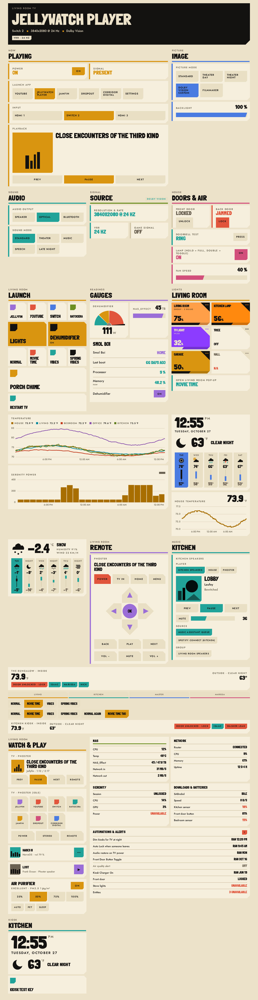
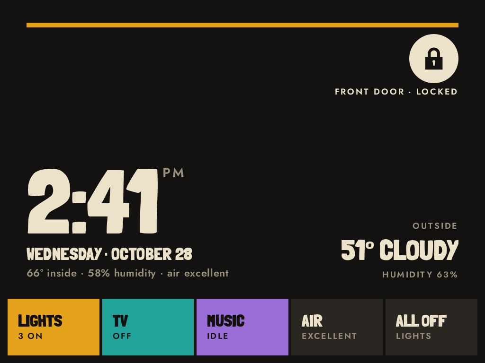

# Jam Cards

Saul Bass inspired Lovelace cards for Home Assistant, poster style: flat colour blocks on an ink ground, straight edges
with one cut corner, one accent colour per card (per room), heavy uppercase display type.




## Install
1. HACS → Custom repositories → `Starkkaman/jam-cards`, category **Dashboard** → Download. The resource is added for you.
2. For the palette, also install the [JamBoard theme](https://github.com/Starkkaman/jam-theme) (HACS category **Theme**)
   and select it. It sets the `--jam-*` colours per light/dark mode; without it the cards fall back to the dark "ink" palette.

All options are YAML. Unknown or unavailable entities render as unavailable instead of throwing.
Fonts bundled (OFL): Londrina Solid and Jost are embedded in `jam-cards.js` (latin subset, licences in `fonts/`), so
nothing is fetched from outside Home Assistant (the screensaver's `images.index` is whatever URL you configure).

## Colours
Every card takes `accent:` — `ochre` (default), `teal`, `blue`, `pink`, `violet`, `green`, `red`, or a room alias:
`living` (ochre), `kitchen` (teal), `master` (blue), `marissa` (pink), `music` (violet), `nerd` (green), `alert` (red).
Anything that is on or selected fills with the accent (ink text); idle controls stay neutral. Red is meant for alerts:
unavailable states, jammed locks and power keys are always red. Cards inside a `jam-popup` follow the pop-up's accent
unless they set their own; inside pop-ups and sheets their surfaces move one step up (card face `--jam-slab2`, inner
keys `--jam-slab3`) so they stand out from the sheet. Status colours: accent = on/active, red = alert/unavailable, teal = calm/informational, line = off.

## Actions
Cards that list `tap_action`, `hold_action` (500 ms) or `double_tap_action` accept standard Lovelace action objects:
`more-info`, `toggle`, `navigate` (`navigation_path`), `url` (`url_path`), `perform-action` / `call-service`
(`perform_action`, `data`, `target`) and `none`. Add `confirmation: true` or `confirmation: {text: ...}` to ask first.

## Cards
22 cards. Every card takes `accent`. The full option list of each card is in the header comment of `src/cards/jam-*.js`.

### jam-heading
Section label with a big title over a 5px accent rule.
```yaml
type: custom:jam-heading
title: Living room
kicker: Downstairs
```
| Option | Description |
|---|---|
| `title` | Title (required) |
| `kicker` | Small label above the title |
| `accent` | Rule colour (see Colours) |
| `entities` | List of entity ids shown as state chips |
| `tap_action`, `hold_action`, `double_tap_action` | Actions |

### jam-hero
Paper slab with a cut corner: a big title (fixed or from an entity), meta line and chips.
```yaml
type: custom:jam-hero
kicker: Living room TV
title_entity: sensor.tv_current_app
power_entity: switch.tv_power
off_title: TV off
```
| Option | Description |
|---|---|
| `kicker` | Small label above the title |
| `title` / `title_entity` | Fixed title, or an entity whose state is the title |
| `meta_entities` | List of entity ids shown as a meta line |
| `power_entity` | When off, shows `off_title` / `off_text` instead |
| `off_title`, `off_text` | Text shown while `power_entity` is off |
| `chips` | List of `{entity, name, show_state, hide_value, tone}`; a chip is hot (accent colour) when its entity is on; `show_state` shows the chip only in that state; `hide_value` hides the value; `tone`: any accent name, or `paper` |
| `accent` | Hot chips and separators (default ochre; see Colours) |

### jam-tile
Entity block with a status stripe and an optional control.
```yaml
type: custom:jam-tile
entity: switch.coffee_machine
```
| Option | Description |
|---|---|
| `entity` | Entity id (required) |
| `name` | Name override |
| `label` | Fixed text instead of the state |
| `control` | `auto` / `toggle` / `lock` / `press` / `none` (auto: lock → lock, button → press, on/off → toggle) |
| `tones` | Map of state → `on` / `alert` / `calm` / `off` |
| `show_last_changed` | Show when the state last changed |
| `tap_action`, `hold_action`, `double_tap_action` | Actions |

### jam-choice
A `select` / `input_select` as option chips; the selected one fills with the accent.
```yaml
type: custom:jam-choice
entity: input_select.house_mode
```
| Option | Description |
|---|---|
| `entity` | select / input_select (required) |
| `name` | Name override |
| `options` | Subset and order of options to show |
| `columns` | Number of chip columns |

### jam-slider
Strip for number / input_number, light brightness, media volume or fan speed.
```yaml
type: custom:jam-slider
entity: light.desk
```
| Option | Description |
|---|---|
| `entity` | number / input_number / light / media_player / fan (required) |
| `name` | Name override |
| `min`, `max`, `step` | Range overrides |

### jam-media
Now playing as a duotone print, with transport, volume, sources, player switch and grouping.
```yaml
type: custom:jam-media
entity: media_player.kitchen
```
| Option | Description |
|---|---|
| `entity` | media_player (required) |
| `name` | Name override |
| `controls` | Subset of `prev`, `play_pause`, `next`, `stop` |
| `show_art` | Show artwork (default true) |
| `show_volume` | Show volume (default: when the player supports it) |
| `sources` | `true` or a list of sources to offer |
| `players` | media_player ids: chip row that switches the controlled player |
| `group` | media_player ids: join / unjoin chips (shown only when both players support grouping) |
| `compact` | Mini layout: 52px art, title, sub line and one key (⋯ with `more`, else play/pause) |
| `size` | `kiosk` (0.6.0, wins over `compact`): fullscreen-sheet layout for jam-kiosk — large square art, big title, sub line, 64 px keys (transport with a media_player, ⋯ with `more`); fills the sheet height |
| `more` | `{title, kicker, cards}`: ⋯ key opening a sheet with these cards (they get this card's hass) |
| `title_entity`, `state_entity`, `picture_entity`, `sub_entities` | Players without a media_player (e.g. a PC): title from an entity state, on/off tone, art from `entity_picture`, sub line of `id` or `{entity, name}`; `entity` is optional then. A title state of `Nothing` / `None` / `Idle` (0.6.1) shows as "Idle" |
| `accent` | Art block, play key, volume fill, active chips |

### jam-button
Chunky key for launchers, scenes, scripts and openers: a small accent square carries the icon; an on light/switch/fan/input_boolean fills the whole key with the accent.
For a light / switch / fan / input_boolean the top-right corner is a **power corner** (tap = toggle; P or Shift+Enter on the
focused key); a tap anywhere else opens the entity's more-info dialog (or runs `tap_action`).
```yaml
type: custom:jam-button
entity: scene.movie_night
accent: red
```
| Option | Description |
|---|---|
| `entity` | Entity id (entity, `name` or `icon` required) |
| `name`, `icon` | Label and icon |
| `accent` | Any accent (see Colours), `paper`, or `ink` (plain key, no square) |
| `color` | HA colour name instead of `accent` (blue/indigo → blue, purple → violet, green/lime → green, cyan → teal, pink → pink, orange/amber/yellow → ochre, red → red, grey → ink) |
| `show_state` | Show the entity state |
| `size` | `normal` (96 px, same as a jam-light card) / `big` (120 px) |
| `tap_action`, `hold_action`, `double_tap_action` | Actions (default tap: scene/script → turn_on, button → press, light/switch/fan/input_boolean → more-info (the power corner toggles), other toggleable → toggle, else more-info) |

### jam-gauge
Half-disc of cut wedges (or a strip) with a big numeral; read-only.
```yaml
type: custom:jam-gauge
entity: sensor.cpu_load
severity: {green: 0, yellow: 60, red: 85}
```
| Option | Description |
|---|---|
| `entity` | Numeric entity (required) |
| `name` | Name override |
| `min`, `max` | Range (default 0–100) |
| `unit` | Unit override |
| `severity` | `{green, yellow, red}` band starts (HA semantics) |
| `style` | `arc` / `bar` |
| `tap_action`, `hold_action`, `double_tap_action` | Actions |

### jam-list
One paper sheet of entity rows (replaces the entities card). Row tap opens more-info.
```yaml
type: custom:jam-list
title: Doors
entities: [binary_sensor.front_door, lock.back_door]
```
| Option | Description |
|---|---|
| `title` | Sheet title |
| `entities` | List of entity ids or `{entity, name, secondary_info: last-changed / none}` |
| `state_color` | Colour states (default true) |

### jam-light
The card is painted in the light's own colour (at full value); big name, brightness number, a brightness strip and a
power corner in shades of that colour. Tap the corner to switch the light on/off, drag sideways to dim, tap anywhere else
to open the light pop-up: brightness bar, two whites or WLED preset cards, hue strip, "Your colours" (saved per HA user),
group members and an off-timer. Keyboard: Enter = pop-up, P or Shift+Enter = power, ←/→ = ±10 %.
On very mid-tone colours (where neither black nor cream text is readable) the name and number sit on black label plates.

A group light (one with member lights) takes the average colour of its members that are on, says "2 of 3 on" while only
some are, and shows one vertical colour band per bulb on its right edge (off bulbs dark). `member_bands: corner` puts the
bands in a small block under the power corner instead.

The pop-up's **Edit** key: tap a white's pencil to rename it and set its warmth (kelvin, within the light's range); tap ×
on a saved colour to remove it; **Done** to finish. Edited whites are saved per HA user and per light.
```yaml
type: custom:jam-light
entity: light.living_room
```
| Option | Description |
|---|---|
| `entity` | light (required) |
| `name`, `icon` | Name and icon |
| `accent` | Fill when the light reports no colour |
| `kicker` | Pop-up label (default the light's area) |
| `whites` | Two `{name, kelvin}` (default Cozy 2200 / Clean 4000; whites edited in the pop-up win) |
| `preset_entity` | A `select` of presets (e.g. WLED) shown as cards instead of the whites |
| `presets` | Extra pop-up chips: `{name, color_temp_kelvin or rgb_color, brightness_pct}` |
| `timer_script` | Off-timer script (default `script.jam_light_off_in`, fields `entity_id` + `minutes`; the row hides without it) |
| `show_brightness`, `show_color_temp`, `show_color`, `show_members` | Show/hide pop-up parts (whites, hue strip + your colours, group members) |
| `member_bands` | Group lights: `full` (default, bands down the whole right edge, black power corner on top) or `corner` (a block under the power corner) |
| `tap_action`, `hold_action` | Card actions (default tap and hold: the pop-up; the power corner always toggles) |

Changed in round 3: tap opens the pop-up (was: toggle), the ⋯ corner is now the power corner, the card is 96 px tall.
Changed in 0.3.0: the ON key, brightness strip row, colour-temperature chips and fixed swatches moved off the card;
`presets` are now pop-up chips.

### jam-popup
Full-screen veil with a sheet of cards, opened by a URL hash.
```yaml
type: custom:jam-popup
hash: "#lights-popup"
title: Lights
cards:
  - {type: custom:jam-light, entity: light.living_room}
```
Open it with a `navigate` action to `#lights-popup`; close with the CLOSE key, a veil click, Esc or browser back.

| Option | Description |
|---|---|
| `hash` | URL hash that opens the popup (required) |
| `title`, `kicker` | Sheet title and label |
| `accent` | Header colour (default ochre); also the default accent of the cards inside |
| `spiral` | Spiral flash on open (default true) |
| `cards` | List of card configs |

### jam-graph
History chart from the recorder: line, step or bars, 1–5 series.
```yaml
type: custom:jam-graph
title: Temperature
entities: [sensor.living_room_temperature]
```
| Option | Description |
|---|---|
| `title` | Title |
| `entities` | 1–5 entity ids or `{entity, name}` |
| `hours_to_show` | Default 24 |
| `style` | `line` / `step` / `bars` |
| `show_current` | Show current values (default true) |
| `min`, `max` | Y-axis range |
| `refresh_minutes` | Default 5 |

### jam-weather
Big temperature, condition word and cut-paper glyph, with a forecast strip and an optional clock.
```yaml
type: custom:jam-weather
entity: weather.home
clock: true
```
| Option | Description |
|---|---|
| `entity` | weather (required) |
| `forecast_type` | `daily` / `hourly` / `twice_daily` |
| `days` | Forecast entries (default 5) |
| `clock` | Show a clock (default false) |
| `clock_size` | `normal` / `big` / `huge` (kiosk: the time scales with the card width) |
| `temperature_entity` | Sensor to use for the current temperature |
| `show_current` | Show the temperature/condition block (default true) |
| `show_forecast` | Show the forecast (default true) |
| `tap_action`, `hold_action`, `double_tap_action` | Actions |

### jam-remote
TV remote: d-pad of cut arrows and keys sending `remote.send_command` (Android TV defaults; also `rewind` MEDIA_REWIND,
`forward` MEDIA_FAST_FORWARD).
```yaml
type: custom:jam-remote
entity: remote.living_room_tv
media_player: media_player.living_room_tv
```
| Option | Description |
|---|---|
| `entity` | remote (optional when `actions` is set: keys without an action are then disabled) |
| `media_player` | media_player for the title/state |
| `name` | Name override |
| `hide_title` | Hide the name and title (set automatically inside jam-tv / jam-media sheets) |
| `rows` | Key layout, e.g. `[[power, home], [dpad], [back, menu]]` |
| `layout` | `full`: power back home settings / tv vol− vol+ / d-pad / prev play next / keyboard captions audio input (`rows` wins) |
| `commands` | Map of key → `send_command` value |
| `actions` | Map of key → action object (overrides the command) |
| `labels` | Map of key → label text |
| `sections` | Colour-coded groups instead of rows: `[{title, accent, rows, entity, actions, commands, labels, active_entity, active_match, power_accent}]`; each group has a 6px left rule in its accent and a header with its title and its `power` key (red; `power_accent: true` = the group accent); keys show a glyph above the label, Play is filled with the accent; `entity: null` = keys run actions only; with `active_entity` the plain row keys are an outlined choice and the one whose `active_match[key]` (else label) equals its state is filled |
| row `rocker` | `[rocker]` in any `rows`: Vol − / Mute / Vol + as one flat block in the accent (keys the remote cannot run are left out) |

The `keyboard` key opens a small sheet: a text field with Send (`send_command` `text:<text>`), Backspace (`DEL`) and
Enter (`ENTER`), as universal-remote-card's Android TV keyboard. Volume and d-pad keys repeat while held.

### jam-tv
Smart TV (Android TV media_player + remote), round 3: an artwork poster (power in its corner) with the title on a solid
ink band, Prev / big Play-Pause / Next, a violet volume rocker (− | Mute | +) and outlined **Remote** and **Source** tabs.
Remote opens a sheet with a jam-remote in a TV group (teal: d-pad, Back / Home / Menu / Settings, Rewind / Play / Forward,
red power) and a Stereo group (violet: rocker, inputs, violet power), with a keyboard key in the header. Source opens its
own sheet: **Inputs** (2-up) and **Apps** (3-up) big colour tiles with a glyph, the one on screen outlined with an
"On now" stamp, then a **Home screen** tile. When the TV is off the card shows "TV off", a big **Turn on** key and quick
source tiles.
```yaml
type: custom:jam-tv
media_player: media_player.living_room_tv
remote: remote.living_room_tv
sources:
  - {name: YouTube, color: red, exact: true, match: {app: [YouTube, com.google.android.youtube.tv]},
     tap_action: {action: perform-action, perform_action: select.select_option,
     target: {entity_id: select.tv_launch_app}, data: {option: YouTube}}}
  - {name: Console, color: green, match: {input: HDMI 1},
     tap_action: {action: perform-action, perform_action: select.select_option,
     target: {entity_id: select.tv_input}, data: {option: HDMI 1}}}
current_app_entity: sensor.tv_current_app
input_entity: select.tv_input
input_app: Live TV
volume_up_action: {action: perform-action, perform_action: script.stereo_volume_up}
volume_down_action: {action: perform-action, perform_action: script.stereo_volume_down}
stereo:
  power_action: {action: perform-action, perform_action: script.stereo_power}
  inputs:
    - {name: TV, tap_action: {action: perform-action, perform_action: script.stereo_input_tv}}
```
| Option | Description |
|---|---|
| `media_player` | media_player (required) |
| `remote` | remote entity (Remote sheet, power) |
| `name` | Kicker when idle / off (default the player's name) |
| `sources` | `{name, color, icon, tap_action, hold_action, match: {app, input}, exact}` tiles (`launchers` still works as an alias); a source whose `match` has `input` is listed under Inputs, the rest under Apps; `icon` = a glyph name (`input`, `app`, `game`, `disc`, `download`, `grid`, `home`, `tv`, `music`, `film`) or an `mdi:` icon (default `input` / `app`); `match.app` / `match.input` = text or list (a plain text = app); `exact: true` (0.3.8, default false) = `match.app` only matches the whole app name, so YouTube does not light for YouTube Music / YouTube TV |
| `source_label` | Name of the Source tab and sheet (default "Source") |
| `current_app_entity` | Sensor whose state is the app in front (label or package id). The tile whose `match.app` equals it (any source, case-insensitive) is marked "On now"; else the first whose `match.app` is contained in it (sources with `exact: true` skip this step) |
| `input_entity` | Select/sensor naming the TV input; the tile whose `match.input` equals it is marked while the TV shows an input |
| `input_app` | current-app values that mean "the TV shows an input" (e.g. `Live TV`); without it the input counts whenever it matches |
| `input_signal_entity` | Optional: the input only counts while this sensor reports a signal (not "No signal" / off / unavailable) |
| | Highlight comes only from these live signals (0.3.5): select states and tap options are not used (`source_entities` is ignored); nothing matches → no tile marked |
| `power_action` | Power triangle and Turn on key action (default `remote.toggle`) |
| `volume_up_action`, `volume_down_action`, `mute_action` | The violet volume rocker on the card (keys without an action are left out; Vol keys repeat while held) |
| `stereo` | `{power_action, inputs: [{name, tap_action, match}], volume_up_action, volume_down_action, mute_action, input_entity, title, accent}`: Stereo group of the Remote sheet (violet; hidden without it; `input_entity` state fills the matching input) |
| `remote_card`, `remote_title` | jam-remote config merged over the default (TV + Stereo `sections`; set `rows`, `layout` or `sections` to replace them; `commands.home` / `actions.home` also drive the Home screen tile); Remote tab + sheet title (default "Remote") |
| `size` | `kiosk` (0.6.0): fullscreen-sheet layout for jam-kiosk — 64-80 px transport keys, rocker and tabs at their own height, the poster takes the rest (art keeps over half of it; kicker + time on one line over a 30-44 px title); off: Turn on + quick tiles; fills the sheet height, nothing under 18 px |
| `accent` | Poster, progress strip, Play key (see Colours); the Remote sheet's TV group is always teal, Stereo violet |

### jam-speaker
Music Assistant speaker (Spotify Connect too), built like the TV card: album art up top (or, while idle, a cut-paper
abstract that changes each time the player goes idle), the title on a solid ink band with a source dot and "Room ·
source", small **Shuffle** and **Favourite** keys at the right of the band, a power corner, then Prev / big Play / Next and
a volume bar. Tap the art or the band to open the **library panel**: tabs Pinned / Recent / Playlists / Albums / Search
(each row: cover, name, type, Play, and a corner tab to pin / unpin), a player bar docked at the bottom, and a Speakers
key (with `speakers`) for grouping rooms (Join / Playing, per-room volume).
```yaml
type: custom:jam-speaker
entity: media_player.kitchen
name: Kitchen
speakers: [media_player.living_room, media_player.phoster]
pinned:
  - {uri: "library://playlist/12", name: Cooking}
  - spotify://playlist/37i9dQZF1DX4sWSpwq3LiO
```
| Option | Description |
|---|---|
| `entity` | media_player (required; a Music Assistant player) |
| `name` | Room name on the band and the panel (default the player's name) |
| `speakers` | media_player ids (or `{entity, name}`) for the Speakers view (panel / kiosk Speakers key); none = no key |
| `pinned` | Music Assistant uris (or `{uri, name, image, media_type}`) shown first under Pinned and on the kiosk shelf; each person's own pins (corner tab on any row) are added after them and saved to their Home Assistant user (`jam_pins`); a config pin they unpin is hidden for them only. A bare uri gets its name from the library |
| `show_shuffle` | Shuffle key on the band (default true; hidden when the player cannot shuffle) |
| `show_favorite` | Favourite key on the band (default true; hidden when the player has no Music Assistant "Favorite current song" button) |
| `favorite_entity` | That button (default: found on the player's device); `false` = no Favourite key. Favourite adds the playing track to the Music Assistant favourites (there is no un-favourite); it lights for a track MA reports as a favourite (MA queue only) or after a tap |
| `config_entry_id` | Music Assistant config entry for the library calls (default: found automatically) |
| `power_action` | Action for the power corner. Default: `media_player.toggle` when the player can turn on/off, else stop (playing / paused) or play (idle) — Music Assistant players usually have no power control |
| `poster_height` | Height in px of the art above the band (default 150, min 72; below 110 the title is one line) |
| `size` | `kiosk`: the K1 layout for jam-kiosk sheets — art flush left (58 %), the right panel in the album's own main colour (ink or paper text, whichever reads), Shuffle / Favourite by the room, huge title, artist · album, progress line with times, Prev / Play / Next, volume − / bar / + and a Speakers key; a shelf of covers along the bottom (pinned, then recent; tap = play; last tile Browse = the library panel, fullscreen). Fills the sheet height, nothing under 18 px, no animation (the progress line moves every 5 s while it is on screen in a sheet) |
| `accent` | Play key, volume fill, power glyph, panel tab underline (default violet) |

### jam-fan
Fan or air purifier: power corner (top-right, tap = on/off), speed steps, preset chips, air-quality sensors in the
label. A tap elsewhere on the card (or on the name) opens more-info; P or Shift+Enter on the focused name = power.
```yaml
type: custom:jam-fan
entity: fan.air_purifier
sensor: sensor.air_purifier_air_quality
```
| Option | Description |
|---|---|
| `entity` | fan (required) |
| `name` | Name override |
| `speeds` | Percent steps (default from `percentage_step`) |
| `presets` | Preset modes to show (default the fan's; `false` or `[]` hides the chips) |
| `sensor`, `extra_sensor` | `id` or `{entity, name}` shown in the label |
| `accent` | Power glyph when on, active speed and preset |

### jam-house
House strip for a landing view: inside / outside temperature, condition word, front door chip (tap = lock), who's home,
alert chips.
```yaml
type: custom:jam-house
inside_entity: sensor.home_temperature
outside_entity: weather.home
lock_entity: lock.front_door
people: [person.alex, person.sam]
```
| Option | Description |
|---|---|
| `inside_entity` | Temperature sensor (required) |
| `outside_entity` | weather or sensor (required) |
| `lock_entity` | Door lock chip |
| `people` | person ids; those at home show as chips with their first name |
| `full_names` | `true`: chips show the full name |
| `alerts` | `{entity, state, name}`: red chip while the entity is in `state` (or on/open/problem) |
| `title`, `kicker` | Title (default the HA location name) and label |
| `compact` | One smaller row (kiosks) |
| `inside_aq`, `outside_aq` | `{entity}` (or an id): "Air · Good" under the temperature, words only; a numeric state is a US AQI shown as its category (Good, Moderate, Unhealthy for sensitive, Unhealthy, Very unhealthy, Hazardous); `extra` is ignored; hidden while the entity is missing/unavailable |

### jam-tabs
Equal-width room tabs; the tab for the current path fills with its accent.
```yaml
type: custom:jam-tabs
tabs:
  - {name: Living, path: /home-dash/living, accent: living}
  - {name: Kitchen, path: /home-dash/kitchen, accent: kitchen}
```
| Option | Description |
|---|---|
| `tabs` | `{name, path, accent}` (required) |
| `sticky` | `true`: the card is `position: sticky` under the header. In HA it only sticks inside its own section, so put the tabs in their own full-width section at the top |

### jam-scenes
Row of scene / script keys; the active scene fills with the accent: the listed scene activated last (its state is the
activation time), or the `current_entity` option when that changed later. Names default to the scenes' friendly names.
```yaml
type: custom:jam-scenes
current_entity: input_select.light_scenes
scenes:
  - {entity: scene.movie_time, data: {transition: 2}}
```
| Option | Description |
|---|---|
| `scenes` | `{entity, name, data}` with scene.* / script.* entities (required) |
| `current_entity` | input_select naming the active scene |
| `wrap` | `true`: wrap onto more rows instead of scrolling sideways |
| `accent` | Active scene fill |

### jam-screensaver
Takes no space on the dashboard; after inactivity covers the screen with a Poster clock + weather word or a photo
slideshow. Built for weak kiosk tablets (minute timer, no animation loops).
```yaml
type: custom:jam-screensaver
idle_seconds: 120
weather_entity: weather.home
active_hours: {from: "06:00", to: "23:00"}
```
| Option | Description |
|---|---|
| `idle_seconds` | Idle time before it shows (default 120) |
| `mode` | `poster` (default) / `images` |
| `mode_entity` | An `input_select` / `select` (state containing photo / image / slide → photos, clock / poster → clock) or an `input_boolean` (on → photos, off → clock) that picks the mode live; unavailable or anything else → `mode`. A change while it is showing takes effect at the next slide. Photos still need `images` (without it: clock) |
| `weather_entity`, `temperature_entity` | Weather word and temperature |
| `kicker` | Label on the poster |
| `images` | `{index (URL of a JSON list of images) or media (a Home Assistant media source folder), interval (20 s), shuffle, fade (crossfade in ms, default 900, 0 = cut)}` |
| `poster_every` | Images mode: every Nth slide is the poster |
| `active_hours` | `{from, to}`: only shows in this window |
| `disable_on` | `{entity, state}` or a list: no screensaver while matched (e.g. a player is playing) |
| `accent` | Poster colour |
| `kiosk` | Hide HA's sidebar and the dashboard header on this dashboard: `"url"` (default) only when the URL has `?kiosk`, `true` always, `false` never |
| `motion` | `false`: turn the jam cards' one-shot motion (entrance, wipes, stamps, sheet stagger) off on this page while the card is on screen (`JamCards.motion = false`); default on |

Photos from Home Assistant's media source (0.4.0): set `images.media` to a folder's `media-source://` id instead of
`images.index`. The folder is browsed when the screensaver starts and then at most once an hour (after an error: retried
after 10 minutes); only images are shown (other files such as `index.json` are skipped), sorted by name, or shuffled with
`shuffle: true`. Each photo is resolved to a short-lived signed URL right before it is shown; the URLs are never stored or
logged. Photos fill the screen letterboxed on ink. If the folder cannot be read the poster clock shows instead.
Each photo crossfades into the next (0.4.1; `images.fade`, default 900 ms, `0` = instant cut; also instant with the
system's reduce-motion setting), and the clock and photos crossfade into each other.
```yaml
type: custom:jam-screensaver
mode: images
images:
  media: "media-source://media_source/local/Photos/slides"
  interval: 20
  shuffle: true
poster_every: 4
```

Kiosk chrome (0.3.3): with `?kiosk` in the dashboard URL (e.g. `/jam-kitchen/0?kiosk`) the card hides Home Assistant's
sidebar and top header and removes the space they reserve, without a kiosk-mode plugin. It applies to the dashboard the
card is on only (it stays hidden while you switch views there, and comes back when you open another dashboard).
Way out: press and hold the top-left corner (48 × 48 px) for 2 seconds; the sidebar and header return until the page is reloaded.

### jam-kiosk
The kiosk home screen (0.5.0, "Poster + dock"): fills the whole view with a huge clock, the date under it in the
display font (0.6.1: its own line), a facts line (inside temperature, humidity, air quality; left out without values), a
"now" line (what is playing, else the weather outside) and a dock of 2-5 flat colour blocks along the bottom. Built to be
read from across the room: nothing under 18 px, one room colour (the bar at the top) plus the dock blocks, no chips.
A block opens a fullscreen sheet with its own cards, or runs an action. Weak-kiosk friendly: one timer per minute, no
animation loops (a block stamps once when pressed). With `lock_entity` (0.6.2) a round lock button sits in the top-right
corner under the bar: a cream (ink in light mode) disc with a closed padlock when locked, a red disc with an open padlock
otherwise; tap locks at once, or asks "Unlock the front door?" first when locked. Put it alone in a full-width section (with jam-screensaver beside it).

```yaml
type: custom:jam-kiosk
accent: living
lock_entity: lock.front_door
inside_entity: sensor.home_temperature
humidity_entity: sensor.home_humidity
aq_entity: sensor.purifier_air_quality
now:
  - {type: media, entity: media_player.tv, states: [playing, paused], kicker: On the TV, app_entity: sensor.tv_current_app}
  - {type: media, entity: media_player.living_room_speaker}
  - {type: weather, entity: weather.home}
dock:
  - name: Lights
    accent: living
    state: {count_on: [light.lamp, light.ceiling, switch.tree]}
    columns: 2
    cards: [{type: custom:jam-light, entity: light.lamp}, {type: custom:jam-light, entity: light.ceiling}]
  - {name: Music, accent: violet, state: {entity: media_player.living_room_speaker}, cards: [{type: custom:jam-speaker, entity: media_player.living_room_speaker, size: kiosk}]}
  - {name: TV, accent: teal, columns: [3, 2], cards: [{type: custom:jam-tv, media_player: media_player.tv, size: kiosk}, {type: custom:jam-media, entity: media_player.pc, size: kiosk}]}
  - name: All off
    accent: none
    state: {text: Lights}
    tap_action: {action: perform-action, perform_action: light.turn_off, target: {entity_id: [light.lamp, light.ceiling]}, confirmation: {text: Turn off every light?}}
```
| Option | Description |
|---|---|
| `accent` | Room colour of the 10 px bar at the top (default ochre); also the sheet colour of `none` blocks |
| `inside_entity`, `humidity_entity`, `aq_entity` | Facts line under the clock: "Tuesday · October 28 · 67° inside · 58% humidity · air excellent" (each part only while its sensor has a value; AQ as a word, a US AQI number becomes its category; wraps between parts, never cut off) |
| `lock_entity`, `lock_name` | 0.6.2: round lock button top-right (≈104 px on a 1024×768 iPad, ≈88 px on an Echo Show 8) with a label line "FRONT DOOR · LOCKED" (just "LOCKED" when it does not fit; `lock_name` default "Front door"). Locked = calm disc in the text colour; Unlocked / Open / Jammed / Locking… / Unlocking… = red disc; unavailable = dim outline and "—". Tap: unlocked / open / jammed → `lock.lock` at once; locked → confirmation "Unlock the front door?" then `lock.unlock`; other states do nothing |
| `now` | Sources for the right-hand block, the first active one wins. `{type: media, entity, states (default [playing]), kicker (default Playing / Paused), app_entity}`: title, else the app; small line = artist, else the app. `{type: weather, entity, temperature_entity, kicker (default Outside)}`: "51° cloudy" + the next change in the hourly forecast within 12 h ("Rain at 3 · high 64°"), else "High 64°", else humidity |
| `dock` | 2-5 blocks: `name`, `accent` (colour or room alias; `none` = plain block with a dim state; default the card accent), `state`, `cards` + `kicker` + `columns` (1-3 equal, or a list of widths such as `[3, 2]` = 60 % / 40 %) for a sheet (cards with `size: kiosk` get the full sheet height), or `tap_action` (confirmation supported); `tap: sheet / action` forces one |
| `state` | `{count_on: [ids], suffix: on}` → "3 on" / "All off"; `{entity, attribute, app_entity}` → the entity's state in words (media player: title while playing / paused, else the app from `app_entity`, else On / Idle, Off when off; lock: "Door locked" / "Door unlocked"; air-quality sensor: Good / Moderate / … or its own word); `{text}` |

The clock follows the Home Assistant profile's time format (12 h with a small AM/PM, or 24 h). The card sizes itself from
its top to the bottom of the screen and re-measures on resize and every minute.

### jam-panel
Compact system panel for a control room: name / value rows, red when a value is bad.
```yaml
type: custom:jam-panel
title: NAS
rows:
  - {entity: sensor.nas_cpu_usage, name: CPU, format: pct, bad: {above: 90}}
```
| Option | Description |
|---|---|
| `title` | Title (required) |
| `rows` | `{entity, name, attribute, max, format (pct / temp / bytes_rate / duration / relative), bad: {above, below, state}, tap_action}` |
| `accent` | 4px rule under the title |

### jam-alerts
Automations by last run, watched entities that must never be unavailable, and a count of unavailable entities.
```yaml
type: custom:jam-alerts
auto: true
limit: 6
watch: [lock.front_door]
```
| Option | Description |
|---|---|
| `automations` | automation ids, or `auto: true` for all of them |
| `limit` | Rows for `auto` (default 6) |
| `watch` | Entity ids shown red when unavailable |
| `show_unavailable_count` | Default true |
| `title`, `accent` | Title (default "Automations & alerts") and accent |

## Design rules
Flat colour, no gradients, no blur, no shadows, no rounded corners, uppercase display type, straight edges with one cut corner.
Motion is one-shot and stepped like cut paper (view entrance, press print, light colour wipe, scene/source stamp, sheet
stagger, kiosk dock stamp); `prefers-reduced-motion` or `JamCards.motion = false` turns it off. The full rules are in [docs/DESIGN.md](docs/DESIGN.md).

## Develop
Source lives in `src/`; `jam-cards.js` is generated by `node tools/bundle.mjs`. `pw-node preview/shoot.js` renders
`preview/index.html` (fake hass) in dark and light at 390 and 1280 px, writes `preview/shots/`, and checks the service
calls of each control (exit 0 = pass). File map: [filemap.md](filemap.md).
